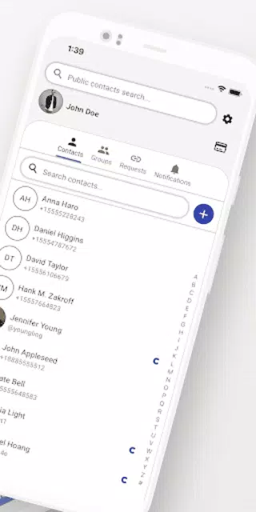

**Professional work · ByteTrix**

## At a Glance

ContaX keeps shared contact details up to date across connected users.

**My contribution:** Built two-way synchronization between the mobile app and backend, native contact integration, and privacy-focused contact matching.

**Core stack:** Flutter, NestJS, PostgreSQL, Drift (SQLite), WebSockets.

---

## Project Gallery
*Visualizing the live synchronization and contact matching engine.*

  
  
  
  

---

## Technical Core & Responsibilities

### ⚙️ Full-Stack Engineering & Architecture
* **Cross-Platform Synchronization:** Engineered a complex two-way synchronization engine bridging the **Flutter** local **SQLite (Drift)** database with the **Nest.js** backend, ensuring data integrity and real-time conflict resolution across the entire stack.
* **Architectural Integrity:** Contributed equally to both the mobile and backend tracks, implementing **Clean Architecture** on the client and **Hexagonal Architecture** on the server to maintain a decoupled and scalable system.
* **Privacy-Centric Logic:** Developed matching algorithms using normalization and hashing to link social connections with phone contacts, prioritizing user privacy while maintaining data accuracy.

### 📱 Mobile Implementation
* **State & Performance:** Utilized **BLoC** for state management and **Isolates** for heavy background processing, ensuring the "live address book" stayed current without impacting device performance.
* **Native Integration:** Leveraged **Flutter Platform Channels** to build deep integrations with native on-device contact books.

### 🖥️ Backend & Infrastructure
* **Real-time Infrastructure:** Designed and implemented **REST** and **WebSocket** endpoints to support instantaneous data pushes and social connectivity.
* **Data & Scaling:** Optimized a highly relational **PostgreSQL** schema and integrated **Redis** for efficient caching, managing the deployment lifecycle via **Kubernetes** and **GitLab CI/CD**.

---

## Tech Stack

### Frontend (Mobile)
* **Language:** Dart
* **Framework:** Flutter
* **State Management:** BLoC, Streams, Get_it
* **Persistence:** Drift (SQLite)
* **Routing:** Auto_route

### Backend
* **Language:** TypeScript
* **Framework:** Nest.js
* **ORM:** MikroORM
* **Infrastructure:** PostgreSQL, Redis, Kubernetes, Grafana

### Services & Tools
* **Communication:** WebSockets, Firebase Cloud Messaging
* **DevOps:** GitLab CI/CD, Firebase (Crashlytics, Dynamic Links, Analytics)
* **Auth:** Supertokens

---

## Impact
As a core Full-Stack Engineer on this project, I bridged the gap between complex mobile hardware constraints and scalable backend services. By building the synchronization engine from the ground up, I helped transform the traditional address book into an automated, living utility that ensures users never lose touch due to stale data.

> [!TIP]
> This project showcases my ability to manage **end-to-end data lifecycles**, from native mobile database synchronization to scalable backend microservices.
