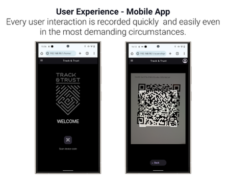
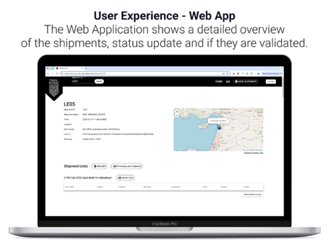

**Professional work · ByteTrix**

## At a Glance

Track & Trust is an ESA-supported supply-chain tracking platform combining satellite connectivity, IoT mesh networks, and blockchain for use in areas with limited connectivity.

**My contribution:** Built the web application, authentication, data encryption, and compression to reduce payload sizes.

**Core stack:** NestJS, PostgreSQL, Svelte.

---

## My Contribution

* **Web Application:** Built the field interaction and shipment dashboard interfaces described below.
* **Authentication:** Implemented user authentication for the application.
* **Encryption & Compression:** Implemented data encryption and compression to protect shipment data and reduce the amount of data transmitted.

-----

## 🛠️ Technical Ecosystem

### Backend & Data

  * **Server/Client Side Architecture:** Built with a robust **NestJS** backend for high-concurrency data orchestration.
  * **Database:** **PostgreSQL** handles complex relational data for shipment history and user management.
  * **Blockchain:** Immutable ledger integration for tamper-proof transaction recording.

### The "Hardware" Mesh

The backbone of the offline network consists of custom-engineered **Mesh Nodes**:

  * **Hardware:** Raspberry Pi units upgraded with long-range antennas, custom adapters, and high-capacity battery packs for field deployment.
  * **Interface:** Each node runs a **Svelte**-based local dashboard, allowing for lightweight, high-performance interaction directly at the edge.

-----

## 📱 User Experience & Interfaces

### 1\. Mobile Webview: Rapid Field Interaction

I built the mobile webview interface for field agents to scan containers and record handoffs.

  * **QR Integration:** Instant container scanning to trigger status updates.
  * **Offline Sync:** Interactions are cached locally on the device or mesh node until a satellite or cellular uplink becomes available.

*The mobile webview's scan-and-record workflow for container interactions.*

### 2\. Web Application: Command & Control

I built the central web dashboard for viewing shipments, validation status, and interaction history.

  * **Shipment Overview:** Real-time tracking of all active containers.
  * **Validation Status:** Visual indicators showing if a shipment update has been successfully validated and recorded on the blockchain.
  * **Status History:** A detailed, chronological log of every interaction point.

*The shipment dashboard with status history and blockchain validation logs.*

-----

## ✨ Key System Highlights

  * **Network Resilience:** IoT-Mesh with Satellite backup (GNSS metadata integration).
  * **Offline Capacity:** Secure data storage until connectivity is restored.
  * **Single Point of Truth:** Authentic data stored immutably in the blockchain.
  * **Privacy-Preserving:** State-of-the-art encryption for all shipment metadata.

-----

## 🚀 Space Added Value

The core innovation lies in the integration of space technologies. By utilizing satellite terminals, we facilitate humanitarian aid in regions with destroyed or non-existent infrastructure. This ensures vital supplies are tracked and accounted for, providing peace of mind to donors and coordinators alike through GNSS-verified location data.
